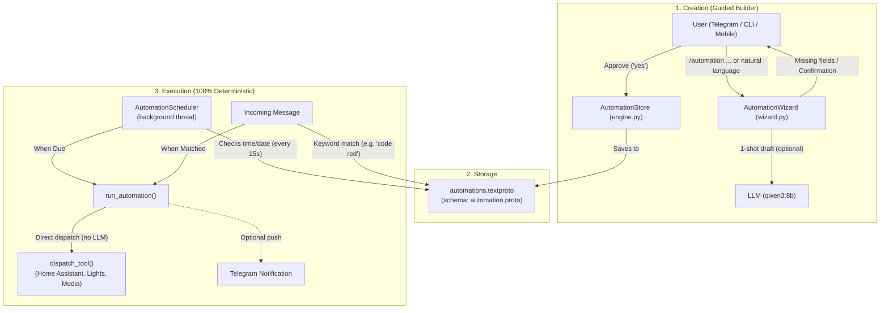

# EtaiAgent Automations System

The automations subsystem is a **declarative, hybrid rules engine** designed to run smart home, media, and notification routines deterministically without relying on an LLM at trigger time.

---

## Architecture Overview

---

## Core Components

| File | Purpose |
|---|---|
| [`automation.proto`](automation.proto) | Protobuf schema defining `Automation`, `Trigger` (time, once, keyword), and `Action`. |
| [`automation_pb2.py`](automation_pb2.py) | Compiled Protobuf bindings generated via `protoc`. |
| [`automations.textproto`](automations.textproto) | Declarative storage of all saved automations. Human-readable and editable by hand. |
| [`engine.py`](engine.py) | Store management, argument type coercion, deterministic execution, and background scheduler. |
| [`wizard.py`](wizard.py) | Conversational interview state machine for drafting, refining, and confirming rules. |
| [`__init__.py`](__init__.py) | Package entry point exposing top-level functions and classes. |
| [`test_automations.py`](test_automations.py) | Unit tests verifying storage, validation, execution, and wizard state transitions. |

---

## 1. Schema & Storage (`automation.proto` & `automations.textproto`)

All automations conform to the schema defined in `automation.proto`:

- **Triggers**:
  - `time`: Recurring time of day (hour, minute) and optional list of weekdays (empty means every day).
  - `once`: Specific ISO datetime (e.g., `2026-10-30T18:00`). Auto-disables after running.
  - `keyword`: Phrase matched against user messages (e.g., `"code red"`).
- **Actions**: Sequence of one or more tool calls with string arguments, coerced to declared tool types at execution time.
- **Notify**: Boolean flag to push a status message to Telegram when executed.

Because the data is stored as a Protobuf text format (`automations.textproto`), you can edit it directly in an editor, and changes are picked up automatically by the engine on the next scheduler tick.

---

## 2. Creation & Guided Builder (`wizard.py`)

Automations can be created via two pathways:
1. **Slash Command**: Sending `/automation <description>` in Telegram or CLI.
2. **Natural Conversation**: Saying *"Every weekday at 7am open the bedroom blinds"*. The agent tool `create_automation` transfers control to the wizard.

### How the Wizard Works
- **Draft Extraction**: Generates a structured JSON draft using a single-shot LLM prompt grounded with known smart home devices and allowed tools.
- **Interactive Questioning**: If required fields are missing or invalid (e.g., time, days, ambiguous devices), the wizard asks follow-up questions one at a time.
- **Confirmation Preview**: Displays the human-readable summary and raw `textproto` block. Users can confirm by replying `yes`, make adjustments (e.g., `time 8pm`, `days weekends`), or type `/cancel` to abort.

---

## 3. Deterministic Execution (`engine.py`)

When an automation triggers, **it does not route through the LLM**. This guarantees speed and execution reliability:

1. **Background Scheduler (`AutomationScheduler`)**:
   - Runs as a daemon thread, polling every 15 seconds.
   - Evaluates active rules against the system's local clock and weekday.
   - Records `last_run` timestamps to prevent duplicate runs within the same minute.
2. **Keyword Execution (`run_keyword_automations`)**:
   - Evaluated before agent turns on incoming CLI or Telegram messages.
   - Executes immediately with zero LLM latency.
3. **Tool Dispatch**:
   - Converts string arguments into target schema types (integer, boolean, float).
   - Invokes `dispatch_tool()` to interface with Home Assistant or other registered systems.
   - Pushes an execution summary to Telegram if `notify: true`.

---

## 4. Safety & Concurrency Safeguards

- **Tool Allowlist**: Only pre-approved device and notification tools are allowed in automations:
  - `control_light`
  - `control_blinds`
  - `cast_to_tv`
  - `watch_on_ps5`
  - `control_ps5_media`
  - `speak_aloud`
  - `desktop_notification`
  *Arbitrary shell commands, Python snippets, and filesystem tools are strictly blocked.*
- **Scheduler Process Lock**: An exclusive OS file lock (`.automations_scheduler.lock`) prevents multiple running processes (e.g., CLI and Telegram bot running simultaneously) from triggering duplicate actions.

---

## Management Commands

Commands can be run from the CLI (`main.py`) or Telegram:

| Command | Description |
|---|---|
| `/automations` | List all saved automations, triggers, and statuses. |
| `/automation <description>` | Start the guided wizard to create a new rule. |
| `/automation show <id>` | Inspect an automation's details and textproto representation. |
| `/automation run <id>` | Manually trigger an automation immediately. |
| `/automation enable <id>` | Enable a disabled automation. |
| `/automation disable <id>` | Disable an active automation. |
| `/automation delete <id>` | Permanently delete an automation. |
| `/cancel` | Cancel an in-progress wizard session. |
